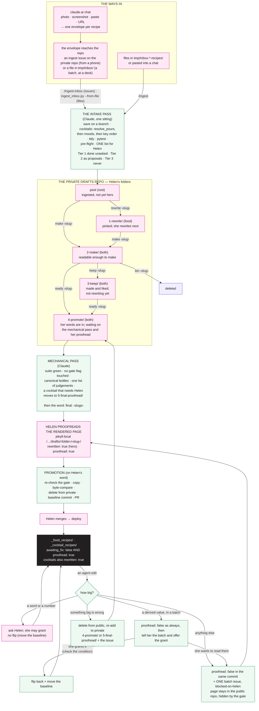

# PIPELINE — how a recipe gets in, gets Helen's words, gets out, and comes back

This is the one map of a recipe's journey, on both sites. Each step's detail
lives in its own document, and this file points there rather than repeating it:

- `.claude/commands/ingest.md` — the ingest contract, the tiers, the `QQ` shapes;
- `.claude/commands/ingest-inbox.md` — the envelope consumer;
- `.claude/commands/tidy-drafts.md` — the formatting pass;
- `PUBLISHING_A_COCKTAIL.md` — the six steps out, in full, and the word "final";
- `CLAUDE_WEB_INGEST.md` — a claude.ai chat;
- MANUAL §4.0 and §9.1.1 — what the gate flags mean;
- `CLAUDE.md` — git, pushing, PRs, and who may set which flag.

**Two things carry state, and they answer different questions.** The
**folders** in a private drafts repo record where Helen is with a file, and
she can move a file between them herself at any time. The **flags** in a
file's `meta:` block record what the suite and the publish gate may assume,
and an agent writes them only where this document says. A folder is never
inferred from a flag and a flag is never inferred from a folder.

---

## 1. The picture

Pink is Helen, green is a session's work, violet is a machine step, black is live.

---

## 2. In: the ways a recipe arrives, and the one intake pass

Helen sends material several ways and the difference is transport only:

| way in | what arrives | who runs what |
|---|---|---|
| a claude.ai chat (`CLAUDE_WEB_INGEST.md`) | one envelope per recipe: the complete file, a "what I could not know" list and a fingerprint | Helen carries the envelopes to the repo by one of the next three rows |
| an `ingest` issue on the matching private repo | one envelope, as issue text, pasted from a phone | Claude: `/ingest-inbox`. `scripts/ingest_inbox.py` parses, deduplicates by fingerprint, writes the file, never repairs |
| envelope files in `tmp/inbox/`, one `.md` per recipe | a batch from a chat, unzipped at a desk | Claude: `python3 scripts/ingest_inbox.py --site food --from-file tmp/inbox/‹slug›.md` (or `--site cocktail`), one call per file. It is a dry run until `--write`. No issue is raised: this is the route for a big batch |
| the `yaml` block of one envelope, saved by hand into the root of a drafts clone | one file | Claude: the finishing pass in `ingest.md` |
| files in `tmp/inbox-food-recipes/` or `tmp/inbox-cocktail-recipes/`, or a paste | photographs, screenshots, text | Claude: `/ingest`. Transcribe by opening every capture |

The three `tmp/` folder names are convention; no script reads them.

Whichever way in, **the same intake pass runs once, in one sitting, and ends
in one list for Helen.** In this order, because each step reads what the one
before it wrote:

1. Save the file on a branch of the private repo, never its `main`.
2. Cocktails: `python3 scripts/resolve_pours.py` reports and `--apply` writes.
   It types each ingredient's `generic` where a declared bottle, a declared
   generic or a wording Helen has ruled on settles it, and leaves the rest `QQ`.
3. Cocktails: `python3 scripts/derive_cocktail_moods.py --write`. The moods
   are computed from the generics step 2 wrote, so they run after it.
4. Cocktails: `python3 scripts/tidy_drafts.py --site cocktails --only order
   --apply`, which puts the top-level keys in page order; the suite fails
   without it. Either site: `/tidy-drafts` if the quoting or typography needs it.
5. `pytest`.
6. `python3 scripts/ingest_preflight.py`, which reports what is valid and
   still needs a person.
7. The list: every rejection, every probable duplicate, every hand-back
   bullet, every undeclared bottle, grouped by decision. Never a question at
   a time: a gap found on the fourth recipe is one line Helen reads once.

**What an ingest does without asking** is `ingest.md` TIER 1: house style
outside `QQ` lines, every fact the source states, the citation
(`SOURCE_ATTRIBUTION_SPEC.md`), the slug, the groups; on food, every method
step as a `QQ original` / `QQ Claude` pair; on a cocktail, millilitres,
canonical method steps, `generic` typed only on an exact match in the
vocabulary, and `suggestion: []`.

**What it never does** is supply anything in Helen's head. Her voice: every
tagline an ingest writes begins `QQ `, on both sites, because the line carries
her name on a published page. `meta.ship`, `meta.rewritten`, `meta.proofread`,
a bottle nobody declared, a category the vocabulary does not settle, a
reconstruction of a truncated step. A silence in the source is `QQ`, never a
default.

---

## 3. The folders, and the five words that move a file

The private repos' subfolders are Helen's: they record where she is with a
file, which no flag can say. They are numbered in pipeline order so they sort
to the top of her file list in the order a file travels, and one name means
one stage on both sites.

| folder | food | cocktails | means |
|---|---|---|---|
| pool (the root) | ✓ | ✓ | ingested; nobody has touched it since |
| `1-rewrite/` | ✓ | — | she has picked it and will rewrite it next. Cocktails skip this stage |
| `2-make/` | ✓ | ✓ | readable enough to make from |
| `3-keep/` | ✓ | ✓ | made and liked, and she is not rewriting it yet |
| `4-promote/` | ✓ | ✓ | her words are in; waiting on the mechanical pass, then her proofread |
| `5-final-proofread/` | — | ✓ | staged for promotion and bounced back: something in it needs Helen and no agent can supply it |

Every folder holds a `.gitkeep`, so it exists when empty, and
`tests/test_staging_folders.py` fails locally when a clone is missing one.

**`4-promote/` means waiting on Claude; `5-final-proofread/` means waiting on
Helen.** The second is the only folder an agent puts a file in unasked. A
cocktail lands there when the mechanical pass finishes and something in it
still needs her: an undeclared garnish, a generic nobody has coined, a choice
between two shapes. The move goes in the same commit as the list of what the
file is waiting for, so the folder and the list never disagree. Food has no
fifth folder.

**Both are the published tense** (`STAGED_DIRS` in `tests/test_cocktails.py`):
a cocktail in either goes live the moment Helen passes it, so the rules that
bite at promotion bite in both. Every `suggestion` is a bottle's canonical
name, never an alias, and no `QQ` is left anywhere.

**Claude moves a file between folders on Helen's word.** Five words, typed in
the chat or in an issue, each followed by one or more slugs:

| she types | Claude does |
|---|---|
| `rewrite ‹slug›` | moves it to `1-rewrite/` (food) |
| `make ‹slug›` | moves it to `2-make/` |
| `keep ‹slug›` | moves it to `3-keep/`: made it, want it, not rewriting it now |
| `ready ‹slug›` | moves it to `4-promote/` and starts the mechanical pass (§4): made it, rewritten it, it ships. Also the way out of `5-final-proofread/` once she has ruled |
| `bin ‹slug›` | deletes it from the private repo: made and disliked |

"I've tried it and want to keep it" is `keep` when she is not rewriting now
and `ready` when the words are already hers. A `3-keep/` file can later become
`rewrite` (food) or `ready`. Every move is a commit on a branch of the private
repo, pushed, and one line in the reply. She can still move files by hand; the
words exist so she does not have to.

**Run `python3 scripts/verify.py` before every push to a drafts repo.** The
private repos have no CI (#1194), and CI on the public repo checks out the
public repo alone. Most draft checks are parametrised per file, so without a
clone they are never created rather than skipped, and the suite reports green
while checking nothing. This is a habit rather than a mechanism, which is why
it is written down: a mechanism only speaks after a push, and this speaks
before one.

**Testing a recipe is reading its rendered page on the local server.** Every
draft renders on `jekyll-local` at `/food/drafts/‹folder›/‹slug›/` or
`/cocktails/drafts/‹folder›/‹slug›/` (a pool file has no folder segment), and
the local index lists every draft with a `draft` badge. Helen starts her own
servers; a session names the URLs.

---

## 4. Out: `4-promote/` to the live site

Six steps, the same on both sites. This is the short version;
`PUBLISHING_A_COCKTAIL.md` has each step in full under the same number.

1. **Helen says `ready ‹slug›`** or moves the file into `4-promote/` herself,
   and sets `rewritten: true` herself. An agent never writes that flag, on
   either site; on a cocktail it is a leg of the publish gate. A file here
   that still says `rewritten: false` will not publish: say so and let her
   set it.
2. **Claude runs the mechanical pass**, touching no gate flag: makes the suite
   green (spellings the vocabularies declare, missing keys, dashes, canonical
   bottle names, list-shaped `suggestion`s) and never changes a tagline, a
   note's words, a method's words or an amount (the full step has the one
   exception, for a note a later ruling has made false). Commit, push.
3. **Claude lists what is not mechanical**, one line each, grouped by
   decision, and moves each cocktail that still needs a ruling into
   `5-final-proofread/` in the same commit. Helen rules.
4. **Claude says `final: ‹slugs›`.** Until that word the served pages are work
   in progress and not for proofreading.
5. **Helen proofreads the rendered page** and sets `proofread: true`. A small
   thing wrong is `awaiting_fix: true` in a commit that says what; it is fixed
   between them, she re-reads, and the flag goes back.
6. **Promotion, on Helen's word**: re-check the gate at copy time, failing
   closed (`awaiting_fix: false` and `proofread: true`, and on a cocktail
   `rewritten: true`); copy into the public collection; byte-compare; delete
   from the private repo; move the baseline constant in a commit of its own
   and prove the guard still bites; check each page by name in the production
   build; run `python3 scripts/verify.py`; open the PR on `main`, naming any
   private branch it depends on. **Helen merges**, and the merge is the deploy.

---

## 5. Back: when an agent touches a published file

**Any agent edit to a published file sets `proofread: false` in the same
commit** (`CLAUDE.md`, Proofreading; MANUAL §4.0), which takes the page off the
live site until Helen reads it again. What happens next comes in four sizes:

| the change | what Claude does |
|---|---|
| a word or a number | **asks first.** She may grant the change without the flip. It then lands as a move of `BASELINE_COMMIT` (or `COCKTAIL_BASELINE_COMMIT`), in a commit of its own, quoting her |
| a derived value, across a batch | flips the flags, then tells her what the batch was and offers her the grant. See "A derived value" below: these pages may never go dark at all |
| anything else | flips the flag, leaves the file in the public repo (the gate hides it), and raises **one** issue for the whole batch, labelled `blocked-on-helen`, with a checklist of every demoted page. She closes it by setting the flags back in a commit with `Fixes #N` |
| something big is wrong | deletes the file from the public repo and re-adds it to the private repo, with the same issue, so it goes back through §4: `5-final-proofread/` for a cocktail that needs a ruling from her, `4-promote/` if it only needs the mechanical pass |

**One issue per batch, never one per file** (`CLAUDE.md`, "never create issues
or PRs in a burst"). The issue is the thing Helen can see: a dark page is
otherwise invisible.

    python3 scripts/needs_helen.py <path> [<path>...] --batch "…" --why "…"

Pass every file being demoted in one call. It validates every path before
changing any, sets each flag, finds the pages that link to each, writes one
body with a checklist to `tmp/needs-helen-batch.md`, and prints the single
command that opens the issue.

**Before opening it, check the tracker for an open `blocked-on-helen` issue
naming one of your slugs.** A page demoted twice does not want two live
issues: comment on the open one and leave that slug out of the new body.

**`python3 scripts/dark_pages.py [ref]` lists everything the gate is hiding**,
on both sites, and is how to check afterwards that the batch is the whole
story. A dark page is invisible by design: the file stays, the page stops
existing, and the cards do not show the flags, so counting is the only thing
that finds one. Pass `origin/main` to ask about the live site rather than the
working tree, and fetch first.

**A demotion can break links.** A live page that links to a demoted one gets a
404 in production, and
`test_no_link_in_the_production_build_points_at_a_file_that_isnt_there` goes
red on `main`. The issue body names the linking pages, so Helen sees the whole
cost.

### A derived value

A derived value is computed by a script from fields Helen has already read (a
mood, for one), and a re-derivation touches many published files at once.
"Ask first" does not fit, because there is nothing to show her until the
script has run; an ordinary demotion asks her to re-read pages where there may
be nothing for her to re-read. So:

1. **Flip the flags, as always.** The rule does not bend for a batch, and a
   session does not pre-judge the grant by skipping the flip.
2. **Run the derivation and say what it did**: how many files, and what
   changed in each. `python3 scripts/derive_cocktail_moods.py` names them.
3. **Offer her the grant, with the batch in front of her.** The grant she has
   given before reads: *"if the only change to those 15 files is the chip
   appearing, I don't need to proofread, please just let them be live."*
4. **If she grants it, check the condition before acting on it.** The grant
   holds only if the diff really is only the derived line. Diff every touched
   file against `main` with a script in `tmp/`, and require every changed line
   to be one you expect; a reordered mood or a changed amount must fail it.
5. **Then one commit flipping back and one moving the baseline**, the baseline
   alone and proved with the old value first.

**If she does not grant it, it is an ordinary batch demotion**: the third row
of the table, unchanged.

She can grant it and the rule still holds, because the value is computed from
what she has read, by a rule she ruled on, and renders as a chip rather than as
prose. That is a reason for her to grant it, not a licence: a session never
assumes the grant and never skips the flip.

---

## 6. What is not built

Steps this map describes that are done by hand:

- `scripts/promote.py` does not exist. The copy, compare, delete and baseline
  steps of §4 step 6 are done by hand, following `PUBLISHING_A_COCKTAIL.md`.
- A `to make (N)` view on the two local indexes, listing exactly the `2-make/`
  folder, is proposed and not built.
